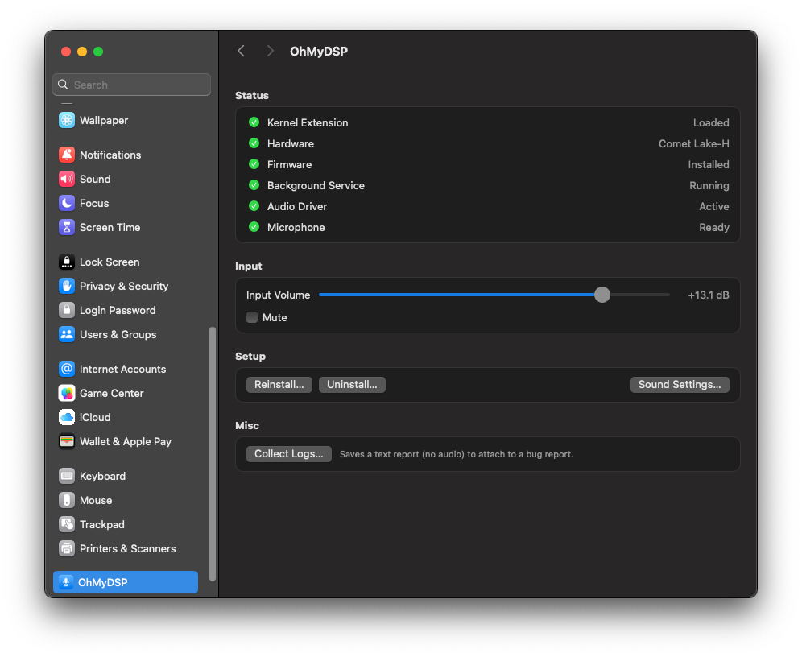
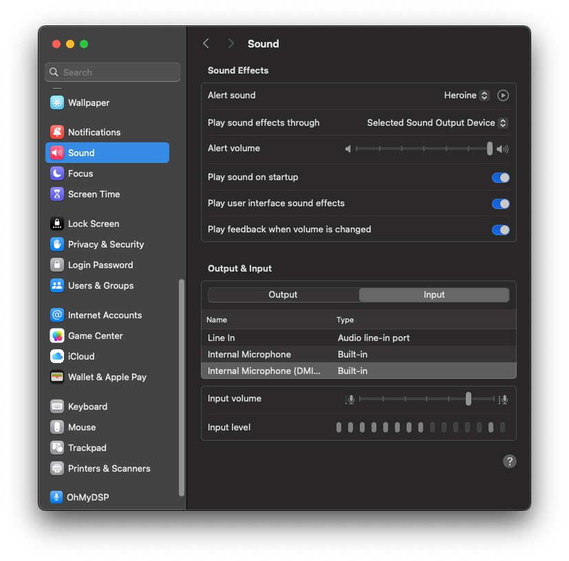

# OhMyDSP

Internal digital microphones (PDM DMIC behind the Intel audio DSP) for macOS on OpenCore hackintoshes, as a companion to AppleALC.

On many laptops the built-in microphones are not wired to the codec AppleALC drives but to the Intel PCH audio DSP (Intel cAVS / SST,
firmware: Sound Open Firmware). AppleALC cannot expose them, so macOS shows a dead "Built-in Microphone". OhMyDSP boots the DSP, runs the
SOF firmware, builds the DMIC capture pipeline and exposes the result as a normal macOS input device, **Internal Microphone (DMIC)**.
AppleALC, AppleHDA and AppleHDAController are never modified or hooked; OhMyDSP only touches the DSP path and uses its own DMA stream.

> [!CAUTION]
> **AI-assisted development.** This project was developed with substantial help from an AI coding assistant (Claude). The code has been
> tested on one machine only, so review it before running it, especially the kernel extension.

> **Status: proof of concept, verified on one machine.** ThinkPad P1 Gen 3 (Comet Lake-H PCH, ALC285 + DMIC), macOS 15.8.2, OpenCore.
> Other Intel platforms are untested, and the capture pipeline is still tied to that platform's topology (see [Compatibility](#compatibility)).
> The software writes to PCI hardware registers. Test with a spare OpenCore USB and read [Safety](#safety).

## Preference pane

<p align="center"></p>

First install on the reference machine (Comet Lake-H, OpenCore-injected kext): the pane checks the hardware, downloads the firmware with a progress bar
([screenshot](docs/images/pane-firmware-download.png)), installs the service and driver, and *Internal Microphone (DMIC)* appears in
System Settings > Sound > Input with a live level meter:

<p align="center"></p>

A System Settings pane (**OhMyDSP**, bottom of the sidebar) in the standard Apple style (grouped cards, semantic colours, light and dark).

| Section | What it does |
|---|---|
| **Status** | Live health of the four pieces: Kernel Extension (loaded), Background Service (running), Audio Driver (active) and Microphone (ready / in use). Refreshes every 2 s and on CoreAudio changes. |
| **Input** | **Input Volume** slider, -28 to +22 dB in 0.5 dB steps (default +9 dB), and **Mute**. These are the driver's real CoreAudio controls, so the pane and *System Settings > Sound > Input* always show the same value. The gain is remembered across restarts. |
| **Setup** | **Install / Reinstall…** and **Uninstall…** of the background service and audio driver with one standard administrator prompt (the payload is inside the pane, no terminal needed); **Sound Settings…** shortcut. |
| **Misc** | **Collect Logs…** saves a plain-text report (versions, boot-args, install state and the last 2 h of OhMyDSP log lines; no audio, no personal files) to a place you choose, to attach to a bug report. |
| **Hints** | Tells you what is missing: kernel extension not loaded (add it to OpenCore), service and driver not installed. |

Planned: firmware download for the detected platform, diagnostics export, platform detection, optional noise suppression.

## How it works

```
OpenCore ── injects ──> OhMyDSP.kext (Boot KC, Lilu plugin)   DSP power-up, firmware load, IPC pipeline, DMA capture ring,
                              │                               health check + recovery, root-only user client
                              ▼
                        ohmydspd (root LaunchDaemon)           opens the user client, copies the ring into shared memory
                              │  XPC + shared memory
                              ▼
                  OhMyDSP.driver (AudioServerPlugIn)           "Internal Microphone (DMIC)": mic join, volume, mute, data source
                              ▼
                    CoreAudio  ──>  any app (Voice Memos, Zoom, ...)
```

Why three parts: an OpenCore-injected kext lives in the Boot kext collection and cannot link IOAudioFamily (System collection), and
coreaudiod's sandbox does not allow a plug-in to open a third-party kext's user client. So the kext only talks to the hardware, a root
daemon bridges it, and a standard AudioServerPlugIn publishes the device. The daemon only serves coreaudiod's driver host (and root), and
stops the DSP when nobody is recording.

## Prerequisites

**Hardware**
- An Intel laptop whose built-in microphones are digital (PDM DMIC) and wired to the PCH audio DSP rather than to the codec. Check: the ACPI `NHLT`
  table lists a DMIC endpoint, or Linux loads the SOF driver for the mics. Only Comet Lake-H is tested, see [Compatibility](#compatibility).

**Software**
- macOS 15.8.2 (Darwin 24.6). Other versions are untested.
- OpenCore with [Lilu](https://github.com/acidanthera/Lilu) injected, and AppleALC working for output and the headset jack (OhMyDSP never touches it).
- Xcode Command Line Tools (`xcode-select --install`) to build.
- An internet connection for the one-time firmware download.

**Downloaded for you**
- The pane downloads the SOF firmware (`sof-cnl.ri`, 0.5 MB out of a 17 MB sof-bin release, checksum-verified) into `/Library/Application Support/OhMyDSP/`.
  The DMIC pipeline blob (`dmic-p10.ipc`, 1.5 KB) ships inside the pane. See [Firmware](#firmware).

**Safety net**
- A spare, working OpenCore USB. The kext writes to PCI registers and a bad build can hang boot ([Safety](#safety)).
- Admin rights: the installer needs them (the pane asks for your password).

## Installation

OhMyDSP is a kext injected by OpenCore (like AppleALC) plus the preference pane, which installs the userspace part.

**1. Build**
```sh
make -C ohmydsp CORE=1                 # kext, Lilu plugin  -> ohmydsp/build/core-lilu/OhMyDSP.kext
make -C ohmydsp/userspace              # daemon + AudioServerPlugIn
make -C ohmydsp/prefpane               # preference pane (needs the line above first)
```

**2. Add the kext to OpenCore**: copy `OhMyDSP.kext` to `EFI/OC/Kexts/` and add it in `config.plist` under `Kernel > Add` **after Lilu**
(keep AppleALC as it is). Restart. If boot misbehaves, use `-ohmydspoff` (kill switch) or your spare USB.

**3. Install the pane**: `open ohmydsp/prefpane/build/OhMyDSP.prefPane`, open **OhMyDSP** in System Settings and press **Install…**
(macOS asks for your admin password; no terminal needed). The pane checks your hardware, downloads the firmware if needed (progress bar), then installs
the background service and the audio driver. After the very first install, restart once so the kernel extension can load the firmware.
The Status card shows when every piece is up.

**4. Use it**: select *Internal Microphone (DMIC)* in *System Settings > Sound > Input*.

**Uninstall**: **Uninstall…** in the pane, then remove the kext from `config.plist`.

> Development only: to try the kext without editing OpenCore, build with `make -C ohmydsp CORE=1 LILU=0` and use
> `sudo sh tools/load-kext.sh core` (manual `kmutil load`) and `sudo sh tools/load-kext.sh unload` before every shutdown or restart.
> The OpenCore injection path itself has not been tested yet on the reference machine; all results so far come from the manual load.

### config.plist changes

What OhMyDSP needs from your OpenCore setup. Items marked *(reference)* are what the tested machine uses; they are not known to be
required, but they are the only combination verified.

| Where | Setting | Why |
|---|---|---|
| `Kernel > Add` | `Lilu.kext` **first**, then `OhMyDSP.kext` (any position after Lilu), plus `AppleALC.kext` | OhMyDSP is a Lilu plugin (it links `as.vit9696.Lilu`); AppleALC keeps output and the headset jack |
| `Kernel > Add > OhMyDSP.kext` | `BundlePath` `OhMyDSP.kext`, `ExecutablePath` `Contents/MacOS/OhMyDSP`, `PlistPath` `Contents/Info.plist`, `Arch` `x86_64`, `Enabled` `true` | the usual kext entry; leave `MinKernel`/`MaxKernel` empty |
| `Kernel > Quirks` | `DisableLinkeditJettison` = `true` *(reference)* | recommended by Lilu for plugins |
| `Kernel > Quirks` | `DisableIoMapper` = `true` *(reference)* | DMA to the capture ring is verified only with the IOMapper (VT-d) disabled |
| `Misc > Security` | `SecureBootModel` = `Disabled` *(reference)* | the setup the tested machine runs |
| `NVRAM > ... 7C436110-...` `boot-args` | keep `alcid=<your AppleALC layout>`; no OhMyDSP boot-arg is required | see [Boot-args](#boot-args) |

No ACPI patch, SSDT or `config.plist` change is made by OhMyDSP itself. Add the kext, restart, then continue with step 3 above. After the
first start, wait about 30 s (the `ohmydsp_delay` default) before the pane reports the microphone as ready.

### Boot-args

**None are mandatory.** With no OhMyDSP boot-arg the kext starts after 30 s, brings the DSP up on demand and shows *Internal Microphone (DMIC)* at
+9 dB. Add arguments to the `boot-args` string (`NVRAM > Add`) separated by spaces.

| Boot-arg | Default | What it does |
|---|---|---|
| `-ohmydspoff` | off | Kill switch: the kext does not start at all and touches no hardware. Use it first if boot misbehaves. |
| `-ohmydspdbg` | off | Verbose logging (health counters, per-channel levels, timestamps) via `log show --predicate 'eventMessage CONTAINS "OhMyDSP"'`. Use it when reporting a bug. |
| `ohmydsp_gain=N` | 9 | Initial input gain in dB (-28 to 21). The slider in the pane or in Sound settings changes it at runtime. |
| `ohmydsp_delay=N` | 30 | Seconds between kext start and the first DSP register read (1 to 600). Raise it if the DSP is not ready at the default on a slow boot. |
| `ohmydsp_sd=N` | 5 | HDA stream descriptor used for capture (0 to 6). It must be one AppleHDA does not use; change it only if the log reports a conflict. |
| `ohmydsp_ring=N` | 128 | DMA ring size in KiB, a multiple of 8 (16 to 1024). Bigger means fewer timestamps and more latency. |
| `ohmydsp_tick=N` | 5 | Position poll interval in ms (1 to 20). |
| `ohmydsp_ts=N` | 0 | `0` stamps the exact ring wrap time, `1` stamps "now" (only for timestamp debugging). |
| `ohmydsp_raw=1` | off | Disable the mic join: left = mic A, right = mic B (diagnostics). |
| `ohmydsp_audio=N` | 2 | `0` no audio device, `1` synthetic 1 kHz tone, `2` live microphones. |

Out-of-range values are logged and replaced by the default; the effective configuration is logged once as `OhMyDSP: config: ...`.
Not OhMyDSP arguments, but present on the tested machine: `alcid=31` (AppleALC layout for the ALC285, needed for output and the headset) and
`-v debug=0x100 keepsyms=1` (boot debugging aids, not needed for normal use). The experimental `ohmydsp_p2*`/`p3*`/`p4*` harness arguments are
listed in [docs/boot-args.md](docs/boot-args.md).

## Firmware

The pane downloads the Sound Open Firmware image itself from the official [sof-bin](https://github.com/thesofproject/sof-bin) release `v2026.09.2`
(`sof/intel-signed/sof-cnl.ri`, also the Comet Lake image; the unsigned `community/` build does not work). Both the download and the extracted file are
checked against pinned SHA-256 values, and the installer re-checks the installed copy. The firmware is Intel's, under its own licence
(`LICENCE.Intel`, installed next to it); it is never stored in this repository.
The DMIC pipeline blob `ohmydsp/data/dmic-p10.ipc` is generated from the SOF topology with `tools/gen-ipc3-dmic.py` (see its header) and bundled into the pane.
A later version will build the pipeline from the machine's NHLT table instead.

## Compatibility

| Platform | Status |
|---|---|
| Comet Lake-H (ThinkPad P1 Gen 3, `8086:06c8`), one working DMIC | **Works** (capture, recovery, sleep/wake) |
| Other Intel cAVS 1.5 / 1.8 / 2.x laptops | Untested. PCI ID matching, register layout and the pipeline are still specific to the above |
| Skylake / Kaby Lake (e.g. ThinkPad X1 Carbon 6th Gen) | **Not possible**: Intel's DSP there has no Sound Open Firmware. The pane detects it and says so |

The pane checks the machine before installing anything: the PCH audio device ID, whether the DSP is enabled in the firmware setup (PCI class `0x0401`, not `0x0403`),
and whether SOF firmware exists for it. Only Comet Lake-H can be installed today; other IDs are reported as "not supported yet" instead of loading unverified firmware.

Known limits: of the two microphones only one is reachable on this laptop (see [docs/2026-11-06-mic-a-experiments.md](docs/2026-11-06-mic-a-experiments.md));
output and headset stay on AppleALC; the first DSP start after a failed boot may need a full power-off.

## Safety

The kext writes to the HDA/DSP PCI function (never to codec verbs, CORB/RIRB or any stream AppleHDA uses) and polls instead of using interrupts.
A bad build can hang boot. Keep a working OpenCore USB, test with the kill switch `-ohmydspoff` in mind, load manually before injecting.
No audio is ever stored by the software; recordings are only made by the apps you use.

## Documentation

Every experiment has a dated note in [docs/](docs/): the Linux/SOF bring-up recipe ([bringup-recipe.md](docs/bringup-recipe.md)), the phase plans and the
results of each step.

## Credits and licence

- [Sound Open Firmware](https://thesofproject.github.io/) (Intel and contributors): firmware and driver sources this work follows.
- [Lilu](https://github.com/acidanthera/Lilu) and [AppleALC](https://github.com/acidanthera/AppleALC) (Acidanthera): plugin framework and the audio setup OhMyDSP complements. Lilu's SDK headers are vendored unmodified in `ohmydsp/third_party/Lilu` (BSD-3-Clause).
- Apple's AudioServerPlugIn sample code structure.

BSD 3-Clause, see [LICENSE](LICENSE).
